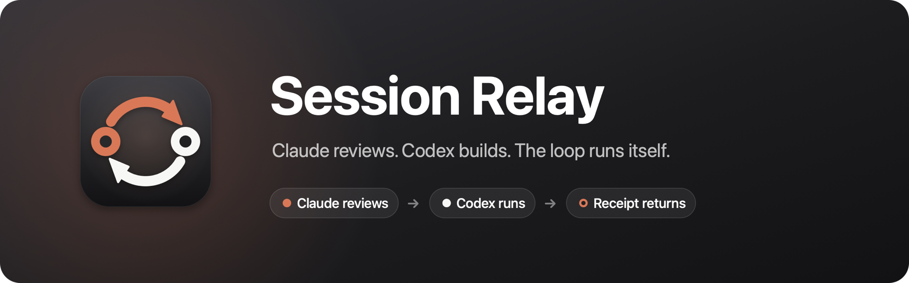
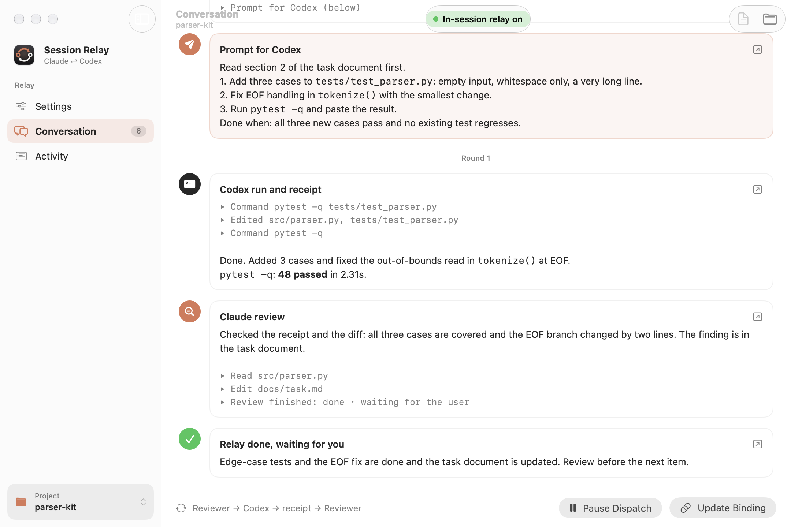
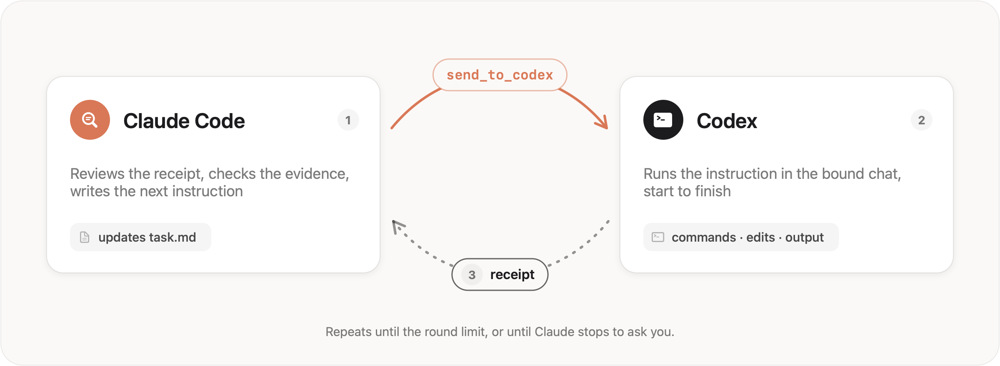

<p align="center"></p>

<p align="center">
  <a href="LICENSE"></a>
  
  
  
  
</p>

<p align="center"><b>English</b> · <a href="README.zh-CN.md">中文</a></p>

Session Relay is a desktop app for macOS and Windows that closes the loop between a **Claude Code** session and a **Codex** chat. Claude reviews the work and writes the next instruction. Codex carries it out. The receipt goes back to Claude for the next review. You no longer copy prompts and outputs between the two windows by hand.

> **Unofficial.** Session Relay is an independent community project. It is not affiliated with, endorsed by or supported by Anthropic or OpenAI. Claude and Claude Code are trademarks of Anthropic; Codex is a trademark of OpenAI.

<picture>
  <source media="(prefers-color-scheme: dark)" srcset="docs/screenshots/chat-dark.png">
  
</picture>

## Highlights

- **One conversation.** In-session relay keeps every review in the Claude desktop window you already use. Nothing forks and nothing hides in another process.
- **Hands-off loop.** Claude dispatches with an MCP tool, a background worker drives Codex, and the receipt wakes Claude for the next review.
- **Many pairs at once.** Keep a pair for each project or each line of work, even several in one project. Each pair has its own Codex chat, reviewer, task document and records.
- **Safe by default.** A round limit, a pause switch, and a rule that each receipt is collected before the next prompt goes out.
- **Everything on record.** Prompts, full receipts, reviews and decisions for every round are saved in your project.
- **Desktop apps.** SwiftUI on macOS and PySide6 on Windows, both with light and dark mode in Chinese and English.

## How it works

<picture>
  <source media="(prefers-color-scheme: dark)" srcset="docs/art/flow-dark.png">
  
</picture>

Each round has three steps:

1. **Claude reviews.** The lead reads the latest receipt, checks the evidence and updates a Markdown *task document* in your project.
2. **Codex runs.** Claude's next instruction is delivered to the bound Codex chat.
3. **The receipt comes back.** Codex's output, including commands and edits, is saved and handed to Claude for the next review.

There are two ways to run it.

| | In-session relay (recommended) | App-driven |
|---|---|---|
| Who reviews | Your Claude Code session, in the Claude desktop window | The app resumes the Claude session from the command line |
| Where you see reviews | The same desktop conversation you already use | The app's **Conversation** page |
| How it dispatches | Claude calls the `send_to_codex` MCP tool | The app delivers the prompt after each review |

## macOS requirements

- macOS 14 or later, with the Apple Command Line Tools (`xcode-select --install`)
- `/usr/bin/python3`, which ships with the Command Line Tools
- [Claude Code](https://claude.com/claude-code), signed in on this Mac
- The Codex app or CLI, with an existing chat for your project

## Build on macOS

```sh
cd /path/to/SessionRelay
./build.sh                      # installs to ~/Applications/Session Relay.app
./build.sh /path/to/Output.app  # or build somewhere else
```

The build is signed ad hoc for your own Mac. A copy downloaded from elsewhere is not notarized and Gatekeeper will block it, so build from source.

## Install and run on Windows

Install and sign in to [Claude Code](https://code.claude.com/docs/en/setup) and Codex. The app looks up `claude` and `codex` on your Windows `PATH`. Install Git for Windows so Claude Code can run the in-session wait command with its Bash tool. Use Claude Desktop for reviews in a desktop conversation.

Download the `Session-Relay-Windows-x64` artifact from a successful Windows Actions run, extract the entire folder to a stable location, and open `Session Relay.exe`. The package includes its Python worker. To run from source or build the package yourself, use Python 3.13 in PowerShell from the repository:

```powershell
py -3.13 -m venv .venv
.venv\Scripts\python.exe -m pip install -r windows/requirements.txt
.venv\Scripts\python.exe -m windows.app
.venv\Scripts\python.exe -m PyInstaller --noconfirm windows/session-relay.spec
& '.\dist\Session Relay\Session Relay.exe'
```

Windows settings and session locks live in `%APPDATA%\Session Relay`. Claude Code uses `%USERPROFILE%\.claude` or `CLAUDE_CONFIG_DIR`. Desktop metadata is looked up in `%APPDATA%\Claude` or the Claude MSIX package's redirected Roaming directory. Set `SESSION_RELAY_CLAUDE_DESKTOP_DIR` before launching when your Desktop installation uses a different data directory.

To preview the Windows interface on macOS, create `.venv`, install `windows/requirements.txt`, and run the frontend with `--demo --lang en` or `--demo --lang zh`. Add `--snapshot dist/windows-screenshots` to export Settings, Conversation, Activity, a streaming review and a status banner in both themes.

## Quick start: in-session relay

1. Open Session Relay and select a pair in the sidebar, or click **+** to add one. Choose its **project folder** and **task document**. The task document can be any Markdown file the lead should read and keep up to date, for example `/path/to/project/docs/task.md`.
2. Pick the **Codex chat** from the project's chats, or paste its ID or link. Pick the **Claude Code session** that reviews, and set a round limit.
3. Click **Turn On In-Session Relay**. This binds the Codex chat and registers the `codex_relay` MCP tools for this project on your computer (Claude Code's local scope), so there is no `.mcp.json` to write and nothing machine-specific in your repository.
4. Start a new conversation in your reviewer session so the tools load.
5. Ask Claude to review and dispatch with `send_to_codex`. From then on, each round works like this:
   - `send_to_codex` hands the prompt to a background worker, which owns the Codex turn until it ends. The tool returns right away.
   - Claude runs the returned `relay.py wait …` command in the background and ends its reply. You can keep chatting meanwhile.
   - When Codex finishes, the wait command exits. The desktop app wakes Claude with the receipt, and Claude reviews it, updates the task document and decides the next step.

### Several pairs in one project

All pairs in a project share one `codex_relay` registration. Claude Code tells the tool which session is calling, and the tool dispatches to that session's pair, so give each pair its own Claude Code session. A project with a single pair accepts any session, as before.

### Safeguards

- No new dispatch until the previous receipt has been collected.
- **Pause Dispatch** in the app stops further dispatches. A running Codex turn still finishes.
- The round limit makes Claude stop and ask you. It calls `start_new_run` only after you agree.
- Each dispatch can require your approval in the desktop window, or you can allow it to run fully automatically.
- `relay_status` shows the bound chat, the task document, the rounds used and any receipt still waiting.

### On another Mac

Install the app, choose the project and task document, paste that Mac's Codex chat ID and click **Turn On In-Session Relay**. Registration happens again automatically. To register without the app, run this in the project folder:

```sh
claude mcp add -s local codex_relay -- /usr/bin/python3 -B /path/to/SessionRelay/relay_mcp.py --live --project /path/to/project
```

## App-driven mode

Choose **App-driven** to let the app run the loop: it resumes the Claude Code session through the CLI for each review. Pick a lead, a starting point (*Latest receipt*, *Goal* or *Resume*) and a round limit, then click **Start Relay**.

These reviews do not appear in the Claude desktop window. Follow them on the **Conversation** page. To keep both sides in step, the app writes a summary to `.session-relay/LATEST.md` and adds your recent desktop messages to the next review. It also pauses if the desktop window used the session in the last five minutes.

## Records

Everything is kept in `.session-relay/` inside your project, which is git-ignored automatically: prompts, full receipts, reviews and decisions for each round. Receipts over 90 KB are also split into 16 KiB pages that Claude can read. **Run Folder** opens the current run in Finder.

## Language

The app and its messages follow your macOS language (Chinese or English). To choose one explicitly:

```sh
defaults write local.sessionrelay.mac AppleLanguages '("en")'
```

## Limitations

Session Relay talks to tools that do not publish a stable interface for this, so a Claude Code or Codex update can break it:

- the Codex App Server protocol (`codex app-server`) and `codex queue`, used to read Codex turns and deliver prompts;
- Claude Code's local transcript files and the Claude desktop app's session metadata, used to list sessions, carry desktop messages into reviews and detect desktop activity;
- Claude Code's `stream-json` output and `claude mcp add`.

A Codex chat or Claude Code session can be in one running relay at a time. It has been tested on macOS 27 with the Codex and Claude Code versions current in late 2026.

## Development

```sh
/usr/bin/python3 -B -m unittest -v test_relay   # protocol tests with local CLI doubles
```

Demo mode renders the UI with sample data and never reads your sessions. With `SESSION_RELAY_SNAPSHOT`, it exports every page in light and dark mode and then quits; that is how `docs/screenshots/` is made:

```sh
SESSION_RELAY_DEMO=1 SESSION_RELAY_SNAPSHOT=/path/to/shots \
  "$HOME/Applications/Session Relay.app/Contents/MacOS/SessionRelay" -AppleLanguages "(en)"
```

| File | Purpose |
|---|---|
| `RelayApp.swift` | App state and back-end processes |
| `Views.swift` | SwiftUI interface |
| `Demo.swift` | Demo data and screenshots |
| `relay.py` | App-driven loop, conversation history, CLI entry points |
| `live.py` | In-session relay: dispatch, background worker, `wait` |
| `relay_mcp.py` | MCP servers: per-review handoff and the persistent `codex_relay` |
| `agents.py` | Claude Code and Codex App Server transports |
| `i18n.py` | Chinese and English messages |
| `en.lproj`, `zh-Hans.lproj` | UI translations |
| `icon/make_icon.swift` | Draws the app icon |
| `docs/art/*.swift` | Draws the banner, social preview and loop diagram |

## License

[MIT](LICENSE)
