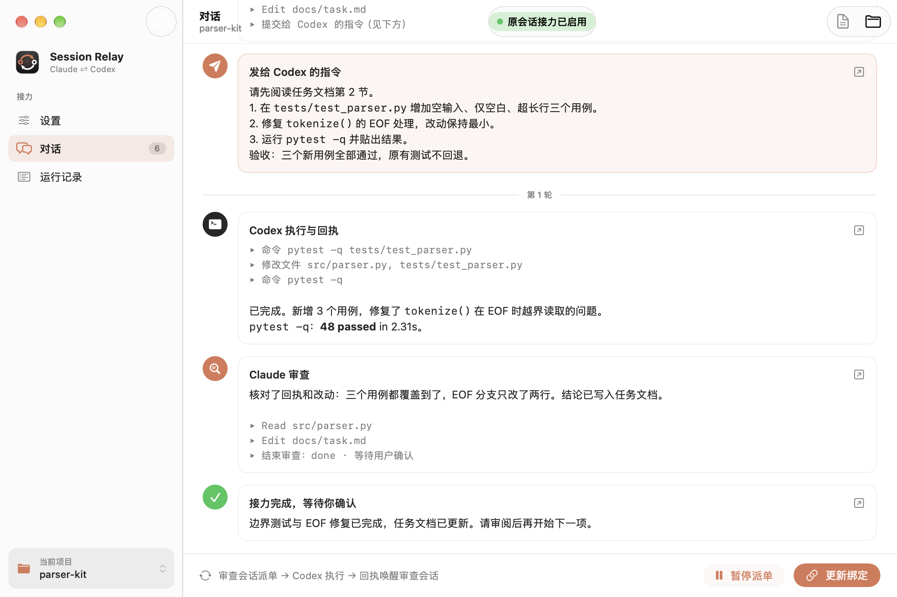

# Session Relay

[English](README.md)

Session Relay 是一个 macOS 小工具，帮你把 **Claude Code** 会话和 **Codex** 会话之间的工作闭环跑起来。Claude 审查进展并写出下一条指令，Codex 执行，回执再交回 Claude 审查。你不用再在两个窗口之间手动复制 prompt 和输出。

> **非官方项目。** Session Relay 是独立的社区项目，与 Anthropic 和 OpenAI 没有任何关联，也未获得它们的认可或支持。Claude 和 Claude Code 是 Anthropic 的商标，Codex 是 OpenAI 的商标。



## 工作方式

每一轮分三步：

1. **Claude 审查**：指挥者阅读最新回执、核对证据，并更新项目里的 Markdown **任务文档**。
2. **Codex 执行**：Claude 写出的下一条指令被投递给绑定的 Codex 会话。
3. **回执交回**：Codex 的输出连同命令和改动一起保存下来，交给 Claude 做下一轮审查。

有两种运行方式。

| | 原会话接力（推荐） | App 驱动 |
|---|---|---|
| 谁来审查 | 你在 Claude 桌面窗口里的 Claude Code 会话 | App 通过命令行续接 Claude 会话 |
| 在哪里看审查 | 就在你平时用的那个桌面对话里 | App 的「对话」页 |
| 怎么派单 | Claude 调用 MCP 工具 `send_to_codex` | 每轮审查后由 App 投递 |

## 环境要求

- macOS 14 或更新版本，装好 Apple 命令行开发工具（`xcode-select --install`）
- `/usr/bin/python3`，随命令行工具一起提供
- [Claude Code](https://claude.com/claude-code)，已在本机登录
- Codex 桌面版或 CLI，并且已经有这个项目的会话

## 构建

```sh
cd /path/to/SessionRelay
./build.sh                      # 安装到 ~/Applications/Session Relay.app
./build.sh /path/to/Output.app  # 或者构建到指定位置
```

构建产物只做了本机临时签名，没有经过公证。从别处下载的副本会被 Gatekeeper 拦下，所以请从源码构建。

## 快速开始：原会话接力

1. 打开 Session Relay，选择**项目目录**和**任务文档**。任务文档可以是项目里任何一个 Markdown 文件，指挥者每轮都会阅读并更新它，例如 `/path/to/project/docs/task.md`。
2. 粘贴 **Codex 会话**的 ID 或链接（在 Codex 会话菜单里复制），设好轮数上限。
3. 点「启用原会话接力」。App 会绑定 Codex 会话，并在本机为这个项目注册 `codex_relay` MCP 工具（Claude Code 的本机作用域）。不需要写 `.mcp.json`，仓库里也不会留下任何本机路径。
4. 在审查会话里开一轮新对话，让工具加载进来。
5. 让 Claude 审查后用 `send_to_codex` 派单。之后每一轮是这样的：
   - `send_to_codex` 把指令交给一个后台进程，由它负责这个 Codex 回合直到结束。工具会立刻返回。
   - Claude 在后台运行工具给出的 `relay.py wait …` 命令，然后结束这轮回复。这期间你可以照常对话。
   - Codex 完成后，等待命令退出。桌面 App 会带着回执唤醒 Claude，Claude 审查、更新任务文档，再决定下一步。

### 保护机制

- 上一份回执收取之前，不能再派单。
- 在 App 里点「暂停派单」后不会再派新单，正在执行的 Codex 回合照常完成。
- 达到轮数上限时，Claude 会停下来问你，你同意后它才调用 `start_new_run`。
- 每次派单可以在桌面窗口里逐次批准，也可以设成全自动。
- `relay_status` 会显示绑定的会话、任务文档、已用轮数，以及还没收取的回执。

### 换一台 Mac

装好 App，选好项目和任务文档，粘贴这台 Mac 上的 Codex 会话 ID，再点「启用原会话接力」，注册会自动重新完成。不用 App 的话，也可以在项目目录里手动注册：

```sh
claude mcp add -s local codex_relay -- /usr/bin/python3 -B /path/to/SessionRelay/relay_mcp.py --live --project /path/to/project
```

## App 驱动

选择「App 驱动」时，由 App 来跑整个循环：每次审查都通过命令行续接 Claude Code 会话。选好指挥者、起点（「最新执行回执」「从目标开始」或「继续上次」）和轮数上限，再点「开始接力」。

这些审查轮次不会出现在 Claude 桌面窗口里，可以在「对话」页查看。为了让两边保持同步，App 会做三件事：把摘要写进 `.session-relay/LATEST.md`；把你在桌面窗口最近说的话带进下一次审查；桌面窗口 5 分钟内用过这个会话时先暂停。

## 运行记录

所有记录都保存在项目的 `.session-relay/` 目录里，这个目录会自动被 git 忽略。每一轮的 prompt、完整回执、审查和结论都在里面。超过 90 KB 的回执还会拆成每页 16 KiB 的分页，方便 Claude 读取。点「运行目录」可以在 Finder 里打开当前这次运行。

## 语言

App 和它的提示信息跟随 macOS 的系统语言（中文或英文）。也可以单独指定：

```sh
defaults write local.sessionrelay.mac AppleLanguages '("zh-Hans")'
```

## 已知限制

Session Relay 用到的几项接口都没有为这种用途提供稳定版本，Claude Code 或 Codex 更新后可能失效：

- Codex App Server 协议（`codex app-server`）和 `codex queue`，用来读取 Codex 回合、投递指令；
- Claude Code 的本地会话记录和 Claude 桌面版的会话元数据，用来列出会话、把桌面对话带进审查、检测桌面活动；
- Claude Code 的 `stream-json` 输出和 `claude mcp add`。

目前只支持 macOS，同一对会话同时只能跑一个接力。已在 macOS 27、2026 年末的 Codex 和 Claude Code 版本上测试过。

## 开发

```sh
/usr/bin/python3 -B -m unittest -v test_relay   # 用本地模拟 CLI 跑协议测试
```

演示模式用示例数据渲染界面，不会读取你的会话。设置 `SESSION_RELAY_SNAPSHOT` 时，它会把每个页面的浅色和深色截图导出到指定目录，然后退出。`docs/screenshots/` 里的截图就是这样生成的：

```sh
SESSION_RELAY_DEMO=1 SESSION_RELAY_SNAPSHOT=/path/to/shots \
  "$HOME/Applications/Session Relay.app/Contents/MacOS/SessionRelay" -AppleLanguages "(zh-Hans)"
```

各文件的作用见[英文 README](README.md#development)。

## 许可证

[MIT](LICENSE)
